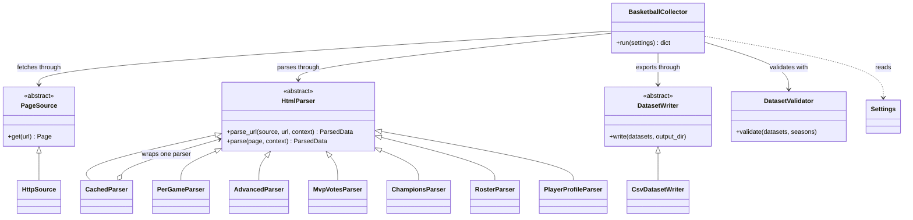
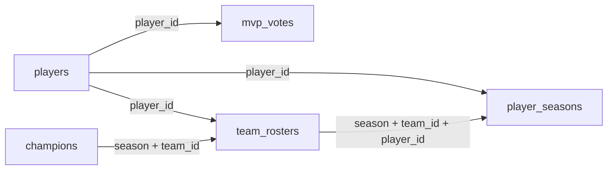

# How the scraper works

The scraper reads HTML from [Basketball Reference](https://www.basketball-reference.com/) and exports NBA data into five linked CSV files. The default range covers 2019-20 through 2025-26. Player statistics cover the regular season; database storage and statistical analysis are outside this collector's scope.

## Execution flow and components

The entry point, [main.py](../../code/main.py), loads settings and connects these components:

| Component | Responsibility |
| --- | --- |
| `Settings` and `load_settings` | Read JSON and CLI arguments and validate configuration |
| `BasketballCollector` | Coordinate season collection and join extracted records |
| `HttpSource` | Fetch pages sequentially and handle network failures; keep HTML only in memory |
| Parsers | Extract per-game and advanced statistics, MVP votes, champions, rosters, and player profiles; handle tables inside HTML comments |
| `CachedParser` | Cache extracted records and skip both fetching and parsing on reuse |
| `DatasetValidator` | Check season coverage, duplicate identities, and record relationships |
| `CsvDatasetWriter` | Stage exports and replace output files after the full run succeeds |

`domain` defines contracts and data structures, `application` coordinates collection, `parsers` extracts HTML records, and `infrastructure` handles fetching and storage. Components communicate through the `PageSource`, `HtmlParser`, and `DatasetWriter` contracts.

Three structures carry data between components: `Page` contains HTML, URL, and fetch time; `ParseContext` identifies the season and team; `ParsedData` contains extracted rows and discovered player/team links.

For each season, per-game statistics provide player records and links when needed. Advanced statistics join those records by player/team identity; MVP votes and champions are collected separately. Team pages provide rosters, experience, and measurements; season age is added from matching per-game records. After season collection, each discovered player's profile is collected once. Only sources needed for the selected outputs are requested.

### Class relationships



`main.py` creates these objects and injects the source, parser dictionary, writer, and validator into `BasketballCollector`. Each dictionary value is a `CachedParser` wrapping a concrete parser. The collector calls `parse_url` for every parser; the wrapper checks cached `ParsedData` before fetching HTML. On a cache miss, it fetches the page and delegates extraction to the wrapped parser. Triangle arrows indicate inheritance, regular arrows show object references, and the diamond marks the wrapped parser reference.

## Entities and CSV relationships

Outputs go to `data/processed/` by default. Player and team IDs come from source links. `season` is the ending year: `2024` means 2023-24.

| File | Main contents | Row identity |
| --- | --- | --- |
| `players.csv` | Name, birth date, height, weight, birth country, and explicitly stated nationality | `player_id` |
| `player_seasons.csv` | Age, position, games, per-game statistics, shooting, and advanced metrics | `season + player_id + team_id + is_total` |
| `mvp_votes.csv` | All players listed in MVP voting, rank, points, and vote share | `season + player_id` |
| `champions.csv` | Champion team ID and name | `season` |
| `team_rosters.csv` | Team-season membership, experience, height, weight, and available season age | `season + team_id + player_id` |



Teams have no separate CSV; `team_id` identifies them in statistics, rosters, and champions. Join roster records to player statistics using rows where `is_total=False`.

Traded players retain individual team rows and an aggregate row. The aggregate has `is_total=True` and an empty `team_id`. For player-season rankings, use the aggregate when present, otherwise the single-team row; never sum aggregate and team rows together.

Missing values stay empty; rookie experience `R` becomes zero. Heights use centimeters and weights use kilograms. Age comes from that season's statistics. Roster players without matching statistics have an empty age; join to season statistics and check games played when selecting active players. Profile measurements are snapshots of the source, not historical measurements. Birth country uses the source URL country code (for example, `US`), not a state name, and is not treated as nationality.

CSV files use `UTF-8 BOM`. Shooting percentages and vote shares are fractions; `usage_pct` follows the source's percentage-point scale. `source_url` and `fetched_at` preserve provenance and UTC fetch time. Advanced statistics and roster age also retain their own source and timestamp. `last_run.json` records row counts and season coverage for the last successful export. Exact columns are defined in `SCHEMAS` in [models.py](../../code/basketball_scraper/domain/models.py).

## Configuration and commands

Run commands from the repository root with GNU Make 3.81 or later and `uv` installed. See the [main setup guide](../../README.md#setup) for prerequisites and the [Makefile guide](../makefile/README.md) for the complete command reference and executable-path overrides.

| Command | Purpose |
| --- | --- |
| `make` or `make help` | List project commands and variables |
| `make setup` | Create the environment and install locked dependencies; use after cloning or pulling changes |
| `make scrape` | Collect selected datasets using the JSON configuration and existing caches |
| `make scrape-refresh` | Fetch and parse again without reusing the parsed cache |
| `make scrape-help` | Show all available scraper options |
| `make test` | Run the scraper's existing automated tests |

The [configuration file](../../config/scraper.json) controls seasons, datasets, output/cache paths, request delay, timeout, attempts, and cache reuse. Select a file with `CONFIG`; pass option overrides through `ARGS`. Precedence is **options in ARGS > selected JSON file > built-in defaults**. Make defaults to `CONFIG=config/scraper.json`; the selected file must exist. All relative paths resolve from the repository root.

| JSON key | Option inside `ARGS` | Default |
| --- | --- | --- |
| `start_season` / `end_season` | `--start-season` / `--end-season` | `2020` / `2026`, inclusive |
| `datasets` | `--datasets` | All five datasets; use filenames without `.csv` |
| `output_dir` / `cache_dir` | `--output-dir` / `--cache-dir` | `data/processed` / `data/raw` |
| `delay` / `timeout` | `--delay` / `--timeout` | 4 / 30 seconds |
| `max_attempts` | `--max-attempts` | 3 attempts, including the first |
| `reuse_cache` | `--reuse-cache` / `--no-reuse-cache` | `true` |

Season ending years currently range from 1947 to 2026, although early historical NBA coverage may be incomplete. Delays and timeouts must be finite positive numbers, and `max_attempts` must be at least one.

Set up and collect one season, or select datasets and a different request delay:

```bash
make setup
make scrape ARGS="--start-season 2024 --end-season 2024"
make scrape ARGS="--datasets mvp_votes champions --delay 5"
make scrape CONFIG="config/custom file.json"
```

Refresh a season, inspect options, or run tests:

```bash
make scrape-refresh ARGS="--start-season 2024 --end-season 2024"
make scrape-help
make test
```

`make scrape-refresh` forces cache bypass even if `ARGS` includes `--reuse-cache`. For paths containing spaces inside `ARGS`, preserve their shell quotes as shown in the [Makefile guide](../makefile/README.md).

## Caching, resuming, and failures

Only extracted rows, source URLs, fetch timestamps, and discovered player/team links are stored in `data/raw/parsed/`; HTML is held in memory during parsing and is not written to disk. After an interruption or failure, rerun the same command to reuse completed results without downloading or parsing those pages again. Cache identity includes the URL, parser type, season, and team; a parser code fingerprint invalidates outdated results. Refreshing or changing parser code replaces the corresponding cache entry rather than retaining another version. Cached results do not expire or automatically check for website changes; use `make scrape-refresh` to fetch and parse again. A parser change also requires downloading affected pages again because HTML is not retained. Legacy HTML caches are no longer read or written.

Requests run sequentially. Temporary network failures and HTTP `429/500/502/503/504` responses receive retries with increasing delays, respecting `Retry-After`. HTTP `403`, missing required tables/columns, or validation failures stop collection.

All selected datasets must be collected and validated before CSV files are replaced; failed runs preserve previous exports. Unselected files remain unchanged, so keep their season ranges consistent or use separate output directories. Run only one collector per output directory at a time. Required directories are created automatically.

Tests use controlled HTML and simulated network responses. A successful live collection on October 19, 2026 covered seasons ending in 2020–2026 and produced all five CSVs: 1,173 players, 5,050 player-season rows, 81 MVP voting rows, 7 champions, and 4,519 roster rows. The [run manifest](../../data/processed/last_run.json) records the export time and row counts. Schema, uniqueness, season coverage, cross-file relationships, and source metadata were checked; a subsequent run reused the cache without network requests. Nationality remains blank because the source profiles did not state it explicitly.

## Limited live check

Use `make smoke` to check one season through six live pages without collecting every team/player or writing CSVs and cache. This runs separately from the full collector using the same HTTP client and parsers. See the [CI guide](../ci/README.md) for the sample selection, configuration, and automatic checks.
